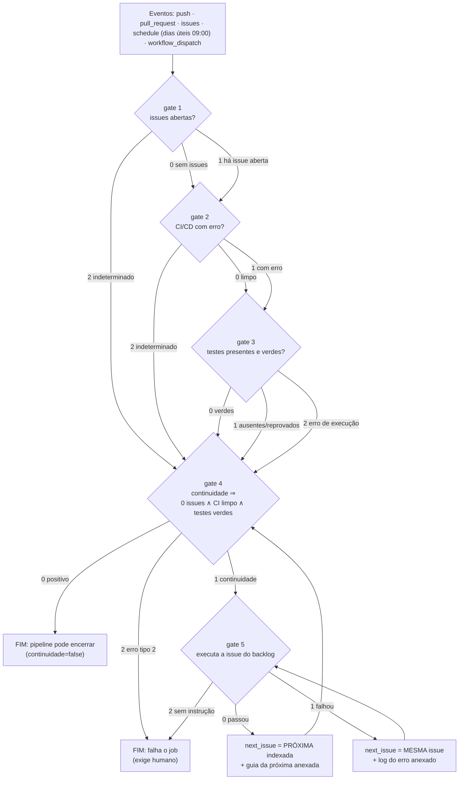

# Pipeline orientado a gates (gate-driven pipeline / blueprint BPMN)

Este projeto tem um **pipeline de portões (gates)** executável localmente **e** no
GitHub Actions. Cada ação devolve **sempre o mesmo objeto JSON**, e o **código de saída
é igual ao `status`** — o que permite encadear gates com `if`/`needs` sem parsing extra.

- Executor: [`pipeline/gate.py`](../pipeline/gate.py)
- Planta (BPMN-like): [`pipeline/blueprint.json`](../pipeline/blueprint.json)
- Fila indexada de issues: [`pipeline/backlog.json`](../pipeline/backlog.json)
- Gatilho no GitHub Actions: [`.github/workflows/gates.yml`](../.github/workflows/gates.yml)
- Testes: [`tests/testar_pipeline.py`](../tests/testar_pipeline.py) (36 testes, offline)

---

## 1. Contrato JSON (igual em todas as ações)

```json
{
  "id": "gate-continuidade-20261013T141603Z-751a07",
  "gate": "continuidade",
  "status": "1",
  "codigo_saida": 1,
  "mensagem": "gate NÃO positivo — continuidade obrigatória. Pendências: issues (1)",
  "continuidade": true,
  "next_issue": "ISSUE-006",
  "anexos": [
    {"path": "pipeline/saida/issues-abertas.md", "filename": "issues-abertas.md",
     "descricao": "lista de issues abertas consultadas pelo gate"},
    {"path": "pipeline/saida/veredito-continuidade.md", "filename": "veredito-continuidade.md",
     "descricao": "veredito do gate em Markdown (resumo para humanos)"}
  ],
  "dados": {"checks": {"issues": {"status": "1"}, "...": {}}, "gate_positivo": false},
  "timestamp": "2026-10-13T14:16:03Z",
  "duracao_s": 0.412,
  "versao": "1.0.0"
}
```

| Campo | Tipo | Regra |
| --- | --- | --- |
| `id` | string | único por execução (`gate-<nome>-<timestamp>-<hash>`) |
| `gate` | string | qual gate gerou (`issues`, `cicd`, `testes`, `continuidade`, `issue`, `blueprint`, `situacao`) |
| `status` | **string** | `"0"`, `"1"` ou `"2"` (ver tabela abaixo) |
| `codigo_saida` | int | espelho do `status`; é o **exit code** do processo |
| `mensagem` | **string** | mensagem pronta **ou** resumo/log da execução |
| `continuidade` | bool | `true` ⇒ o pipeline **deve continuar** (trabalho pendente) |
| `next_issue` | string \| null | a **mesma** issue se falhou; a **próxima** indexada se passou; `null` se acabou ou não se aplica |
| `anexos` | array | `{path, filename, descricao}` — artefatos gerados (logs, listas, veredito, guia da próxima issue) |
| `dados` | objeto | detalhes estruturados de cada gate |

### Códigos

| status | nome | significado | continuidade | exemplo |
| --- | --- | --- | --- | --- |
| `"0"` | **SUCESSO** | gate positivo: nada pendente | `false` | sem issues abertas, CI limpo, testes verdes |
| `"1"` | **ERRO TIPO 1** | pendência **conhecida e tratável** | **`true`** | existe issue aberta; CI vermelho; teste ausente/reprovado; instrução da issue falhou |
| `"2"` | **ERRO TIPO 2** | **não foi possível avaliar** | `false` | `gh` ausente/sem credencial; blueprint inconsistente; issue sem instrução; chave do CNJ recusada |

> **Regra de ouro do projeto:** o gate só é **positivo** quando não há issue aberta **E**
> o CI não tem execução com erro **E** existem testes presentes e aprovados.
> **Enquanto não for positivo ⇒ `continuidade = true`** e `next_issue` aponta a próxima
> pendência do backlog — é isso que mantém o fluxo andando sem sessão humana.

---

## 2. Fluxo (blueprint tipo BPMN)



A mesma planta está em `pipeline/blueprint.json` (consumida pelo comando
`gate.py blueprint`, que **falha com status 2** se a planta e a implementação divergirem —
gate sem código, transição sem destino, etc.).

---

## 3. Comandos

```bash
# verificação isolada (cada um devolve JSON e sai com 0/1/2)
python3 pipeline/gate.py issues        # existem issues abertas?      (gh issue list)
python3 pipeline/gate.py cicd          # há execução de CI com erro?  (gh run list)
python3 pipeline/gate.py testes        # testes presentes e verdes?   (make testes)
python3 pipeline/gate.py blueprint     # a planta é consistente?

# veredito agregado (o "gate" propriamente dito)
python3 pipeline/gate.py continuidade

# executa a instrução da issue: sucesso ⇒ próxima indexada; falha ⇒ mesma
python3 pipeline/gate.py issue                  # próxima pendente do backlog
python3 pipeline/gate.py issue --id ISSUE-006   # uma issue específica
python3 pipeline/gate.py issue --marcar         # e persiste a conclusão no backlog

# leitura do histórico
python3 pipeline/gate.py situacao

# modo offline/fixture (usado pelos testes e por quem não tem gh)
python3 pipeline/gate.py issues --issues-json fixture.json
python3 pipeline/gate.py cicd   --runs-json fixture.json
python3 pipeline/gate.py issues --sem-gh        # ⇒ status 2 (erro tipo 2, sem fonte)
```

### Encadeando jobs (como o workflow faz)

```bash
python3 pipeline/gate.py continuidade \
  --status-issues "$S_ISSUES" --status-cicd "$S_CICD" --status-testes "$S_TESTES"
```

Assim o agregador **não reexecuta** a suíte: ele recebe o resultado de cada job
(`needs.<job>.outputs.status`), que é o padrão de `needs` do GitHub Actions.

---

## 4. Fila de issues (`pipeline/backlog.json`)

Cada item tem `id` sequencial, `titulo`, `entregavel`, **`instrucao_teste` executável** e
`status` (`concluida` | `pendente` | `bloqueada`). O gate `issue`:

1. localiza a issue (informada ou a **primeira pendente**);
2. roda a `instrucao_teste` e **anexa o log**;
3. **código 0** ⇒ `status "0"`, `next_issue` = próxima indexada e anexa
   `<ID>-proxima-issue.md` com a instrução da seguinte (com o comando pronto);
   com `--marcar`, grava `status: concluida`, `concluida_em` e `evidencias`;
4. **código ≠ 0** ⇒ `status "1"`, `next_issue` = **mesma issue**, log anexado
   (continua tentando até ficar verde);
5. **sem `instrucao_teste`** ⇒ `status "2"` (exige decisão humana — usado de propósito na
   ISSUE-007, que depende de escolha do usuário).

Situação atual do backlog: ISSUE-001…005 concluídas, **ISSUE-006 pendente** (validação ao
vivo contra o CNJ — requer internet) e ISSUE-007 bloqueada (decisão humana).

---

## 5. O workflow (`.github/workflows/gates.yml`)

| Job | Gate | Saída |
| --- | --- | --- |
| `gate-issues` | issues abertas | outputs `status`, `continuidade` + artifact |
| `gate-cicd` | CI/CD com erro | outputs `status`, `continuidade` + artifact |
| `gate-testes` | suíte completa | outputs + `log-testes-*.txt` |
| `gate-continuidade` | veredito agregado | `status`, `continuidade`, `next_issue`; **falha o job se status 2** |
| `executa-issue` | roda a próxima issue | executa a `instrucao_teste`, publica log/guia; com `marcar=true`, commita o backlog |

Todo job publica o JSON no log, o veredito no **job summary** (`$GITHUB_STEP_SUMMARY`) e os
artefatos via `actions/upload-artifact` — os "anexos" do contrato ficam baixáveis.

Gatilhos: `push`, `pull_request`, `issues` (aberta/fechada/reaberta), `schedule` (dias úteis
12:00 UTC) e `workflow_dispatch` (com os inputs `issue` e `marcar`).

```bash
# disparar manualmente (depois que o arquivo estiver na branch padrão)
gh workflow run gates.yml -f issue=ISSUE-006 -f marcar=false
gh run list --workflow=gates.yml
```

---

## 6. Como os testes cobrem o pipeline

`tests/testar_pipeline.py` (36 testes, offline) verifica:

- **contrato**: as 11 chaves obrigatórias em todos os gates, `status` string, `anexos` com
  `{path, filename, descricao}`, `codigo_saida == status == exit code`, arquivos anexados
  existindo no disco, `--json-saida`;
- **issues**: com pendência ⇒ `1`/continuidade; vazio ⇒ `0`; sem fonte ⇒ `2`;
- **cicd**: `failure`, `timed_out`, `startup_failure`, `action_required`, `cancelled` ⇒ `1`;
  sucesso e `in_progress` ⇒ `0`;
- **testes**: comando OK ⇒ `0`; comando falho ⇒ `1` com o log anexado;
- **continuidade**: pendência em qualquer check ⇒ `1` + `next_issue`; tudo limpo ⇒ `0`
  (`next_issue: null`); `2` propaga; anexo do veredito em Markdown;
- **issue**: sucesso avança para a próxima (e anexa a guia), falha mantém a mesma,
  sem instrução ⇒ `2`, `--marcar` atualiza o backlog, `--marcar` ausente não altera;
- **blueprint/backlog**: planta do projeto consistente, planta quebrada ⇒ `2`, backlog
  íntegro (ids sequenciais, instruções apontando para arquivos existentes);
- **workflow**: gatilhos exigidos, os 5 jobs, chamadas ao executor, publicação de JSON/
  summary/artifacts, `status 2` derrubando o job, e checagem estrutural do YAML
  (sem tabulação, indentação par) — a validação definitiva do YAML é a execução real no
  Actions.

```bash
python3 tests/testar_pipeline.py         # 36 testes
make gates                               # veredito de continuidade de verdade
```
